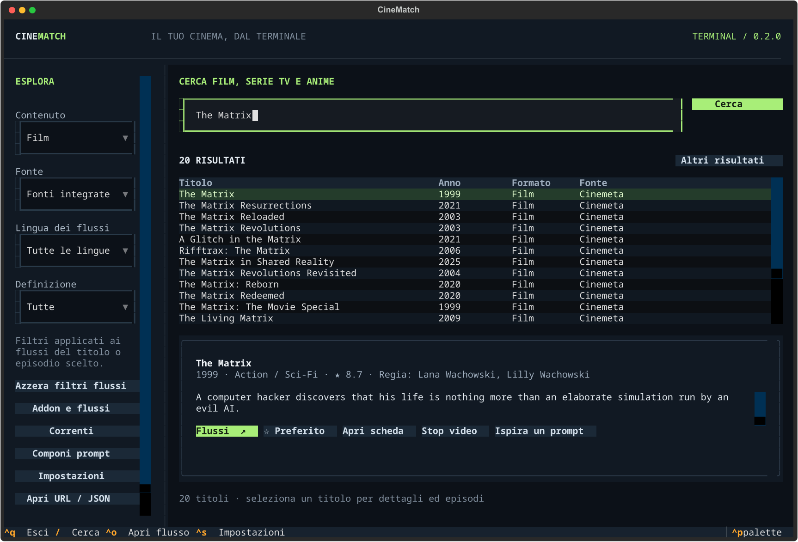

# CineMatch — ora anche nel terminale

La nuova **CineMatch Terminal 0.2.1** porta ricerca di film, serie, anime e TV,
addon JSON, Real-Debrid/TorBox, preferiti, cronologia, 74 correnti cinematografiche
e generazione locale di prompt in un’app TUI per Linux e Windows.

```sh
curl -fsSL https://raw.githubusercontent.com/Emanueleparis98/cinematch/main/terminal/install.sh | sh
cinematch
```

Su Windows, con Scoop già installato:

```powershell
scoop bucket add cinematch https://github.com/Emanueleparis98/cinematch
scoop install cinematch/cinematch
cinematch
```



[Installazione completa, Arch/pacman, Windows PowerShell, uso e privacy](terminal/README.md)
· [Release terminale 0.2.1](https://github.com/Emanueleparis98/cinematch/releases/tag/terminal-v0.2.1)

Per i video aggiungi i tuoi addon e installa mpv o VLC. Per i prompt non serve
alcuna API AI. L’app terminale ha un proprio canale di aggiornamento; seguono
le istruzioni dell’estensione browser, che rimane disponibile.

---

# CineMatch — estensione browser 3.20.2

La **3.20.0** aggiunge la scheda **Flussi** al popup: addon manifest JSON e
una chiave globale Real-Debrid oppure TorBox per i torrent restituiti dagli
addon compatibili. La modalità Live TV / Sport ritirata non è inclusa. Le richieste restano isolate
quando si cambia la chiave del servizio. La **3.20.2** spiega i rifiuti Real-Debrid
451/codice 35 e distingue errori di IP e quota da una chiave non valida.
Il player torna alle sorgenti invece di proporre un nuovo tentativo sul file bloccato.
Questa correzione non rende disponibili i contenuti rifiutati dal servizio.

**La versione corrente è un'estensione per Chrome e Edge**, con 74 voci sulle
correnti del cinema e un generatore locale di prompt per ChatGPT, DeepSeek,
Claude e Gemini. Si apre accanto alla chat e inserisce il testo nell'editor:
l'invio rimane all'utente. Aggiunge automaticamente locandine, cast e registi
sotto i titoli nelle risposte. Non richiede app Windows o API AI a pagamento; le immagini usano una
credenziale personale TMDB, configurabile nelle opzioni dell'estensione.

## Installare l'estensione

Estrai `CineMatch-Chrome-3.20.2.zip`, apri `chrome://extensions`, attiva
**Modalità sviluppatore**, premi **Carica estensione non pacchettizzata** e scegli
la cartella che contiene `manifest.json`. Fissa CineMatch alla barra dal menu
Estensioni: l’icona apre il **popup compatto delle impostazioni**; da lì colleghi
TMDB e attivi le funzioni, comprese le **Correnti in DeepSeek**. In Edge:
`edge://extensions`.

**Per aggiornare senza perdere TMDB e addon**, da una versione 3.6.0 o successiva
usa il popup → scheda **Aggiorna**. Se arrivi da una versione
precedente alla 3.6.0, sostituisci i file nella cartella che stai già usando (la vedi in
`chrome://extensions` → dettagli → “caricata da”) e premi **Reload**; dalla 3.6.0
in poi il self-updater mantiene ID, credenziali e addon. Il pulsante su TMDB
richiede un permesso **opzionale** che attivi tu dal popup delle impostazioni.

[Istruzioni complete, permessi e privacy](extensions/cinematch/README.md).
Chrome 116+; Edge con Chromium recente. Pacchetto manuale, non pubblicato sullo store.

## Flusso nel browser

1. **Componi** si apre in **Richiesta libera**: scrivi senza scegliere una corrente.
   Per usare il catalogo passa a **Con una corrente** e a **Esplora**.
2. Cerca per corrente, autore, opera o sinonimo e consulta contesto e fonti.
3. Seleziona fino a quattro voci. La modalità libera conserva le selezioni ma le
   ignora finché non torni a **Con una corrente**.
4. Aggiungi obiettivo o dettagli se servono. Genera e modifica la richiesta.
5. Apri la chat, premi **Inserisci nella chat**, rileggi e invia dal sito.
   **Copia** permette di usare qualsiasi altra chat. Una bozza già presente
   richiede la tua scelta prima di essere modificata.

Per le immagini collega TMDB una volta dal pulsante nell'intestazione del pannello.
Le immagini appaiono da sole sotto ciascun titolo mentre la chat risponde:
locandina, regista e primi interpreti. Possono mostrare un discreto pulsante
**Flussi** per aprire il player. Seguono colori e caratteri della chat, senza
pannelli, titoli duplicati, impostazioni o moduli di ricerca. Gli abbinamenti
incerti vengono omessi, lasciando leggibile il testo originale. Emoji,
numerazioni e sottotitoli tradotti vengono gestiti automaticamente.

### Pulsante Flussi su TMDB

Dalla 3.8.0 puoi mostrare lo stesso pulsante sui poster di **themoviedb.org**:
film e serie TV, compresi i poster delle card e la locandina principale. Si
attiva dal popup → **Funzioni → Pulsante Flussi su TMDB** e richiede un permesso opzionale
solo per quel sito. Non serve per le immagini nelle chat.

Per le serie TV il player chiede stagione ed episodio, interroga gli addon con
le richieste `series` e conserva un punto di ripresa separato per ogni episodio.
Gli addon collegati con versioni precedenti potrebbero aver conservato solo il
tipo film: se una serie non compare, ricollega il manifest dell’addon.

### Addon e chiave globale per i torrent

Nel popup → **Flussi** aggiungi l’URL del manifest JSON degli addon. La lista
è condivisa con il player: puoi attivare, disattivare e rimuovere gli addon.
Se il player è già aperto, premi Aggiorna sorgenti per rileggere la configurazione.

Nella stessa scheda scegli **Real-Debrid** o **TorBox**, inserisci la chiave API
e premi **Verifica e salva**. È attivo un servizio alla volta: cambiare servizio
sostituisce la chiave precedente. La chiave resta in chrome.storage.local,
accessibile ai contesti fidati dell’estensione; non viene restituita alle chat
né inserita nei manifest degli addon. Non è una cifratura contro chi può
accedere al profilo del browser.

Gli addon devono restituire un hash BitTorrent v1 valido (40 caratteri hex,
anche da magnet), con eventuale indice del file. CineMatch risolve il torrent
al click su Riproduci. Real-Debrid può aggiungerlo all’account e avviarne la
preparazione; se non è pronto, mostra Riprova torrent. TorBox aggiunge solo
contenuti già in cache. Account, piano, disponibilità e limiti del servizio
rimangono necessari. Per le serie si usa l’indice fornito dall’addon oppure
l’identificazione dell’episodio nel nome del file, evitando abbinamenti ambigui.

Gli addon che impongono una configurazione obbligatoria sul proprio server
possono ancora richiederla: una chiave globale non sostituisce ogni schema
proprietario. Le API usate sono quelle ufficiali di
[Real-Debrid](https://api.real-debrid.com/) e
[TorBox](https://api-docs.torbox.app/).

### Modalità CB01

Dalla 3.9.0 puoi attivare **Modalità CB01** dal popup → **Funzioni** per aprire
`cb01one.org` senza pubblicità e con un pulsante **Guarda con CineMatch** su
film e serie TV. Il click sulla locandina apre il player CineMatch, risolve la
sorgente Mixdrop disponibile e la riproduce nello stesso overlay, senza cambiare
pagina. Nella scheda film il blocco player originale viene sostituito da una
card pulita; per le serie è disponibile la scelta di stagione ed episodio.
L’accesso a CB01 e ai suoi player è un permesso opzionale, richiesto solo quando
attivi la modalità. Le sorgenti che richiedono un CAPTCHA non vengono aggirate:
CineMatch passa alla sorgente successiva o mostra un messaggio chiaro.

La modalità blocca le reti pubblicitarie e i tracker osservati con regole di
rete e filtri cosmetici, impedisce i popunder e non carica gli iframe player
originali nella pagina. Il player CineMatch riproduce il file diretto, quindi
non mostra annunci. Nessun adblock è garantito al 100%: la lista viene
aggiornata con le release.

Vengono analizzate localmente le risposte dell'AI, non i messaggi dell'utente.
TMDB riceve titoli, anni o nomi, non la conversazione. Nessun invio automatico
di messaggi e nessuna API AI. Quattro host AI e i due host ufficiali TMDB autorizzati;
nessuna cronologia o accesso generale iniziale ai siti. Addon, sorgenti video,
pulsante su themoviedb.org e modalità CB01 richiedono permessi opzionali per
singolo host. La chiave non viene esposta alle chat.
La bozza è conservata in memoria per la sessione del browser, senza archivio
progressivo di film o richieste. I limiti della chat rimangono quelli del servizio.

## Aggiornamenti

Dalla **3.6.0** le versioni successive si installano dal popup → scheda
**Aggiorna**: scegli una volta la cartella da cui hai caricato
l’estensione, poi CineMatch scarica l’ultima release, verifica lo **SHA-256**,
estrae il pacchetto e aggiorna quella cartella. L’estensione si ricarica da
sola: TMDB, addon e impostazioni restano perché l’ID e la cartella non cambiano.
La cartella resta ricordata anche se un riavvio non viene subito confermato.
Se il browser richiede di nuovo l’accesso, **Conferma accesso e aggiorna** usa
la cartella già salvata senza riaprire la scelta della cartella. Il pulsante
**Aggiorna ora** apre una finestra persistente e continua automaticamente quando
l’accesso è già autorizzato. Prima di modificare i file, CineMatch verifica che
la cartella scelta sia quella effettivamente caricata dal browser.
La **3.20.2** include già l’updater: per una nuova installazione usa lo ZIP
3.20.2, mentre chi arriva da una versione precedente alla 3.6.0 deve fare ancora
un aggiornamento manuale.

L’icona dell’estensione mostra un badge quando è disponibile una nuova versione;
il controllo periodico richiede una sola autorizzazione a GitHub. La scheda
**Aggiorna** spiega anche cosa fare se viene scelta la cartella sbagliata.

## Correnti e prompt in DeepSeek

Dalla 3.13.0 l’icona dell’estensione apre un **popup compatto delle impostazioni**,
senza cambiare pagina e senza correnti: connessione TMDB, **Flussi** su TMDB,
**CB01** e **Correnti in DeepSeek**, più la scheda **Aggiorna**. Il popup
segue il tema chiaro/scuro del sistema. La vecchia pagina delle impostazioni
complete non esiste più.

Le correnti restano nel composer di `chat.deepseek.com`. Attiva **Correnti in
DeepSeek** dal popup: il pulsante **Correnti** compare accanto a **Pensiero
Profondo** e **Ricerca**. Premendolo si apre il popup con ricerca, elenco delle
**74 correnti**, selezione fino a quattro voci e modalità **Richiesta libera**.
Le opzioni avanzate stanno in un pannello richiudibile; il prompt generato si può
copiare o inserire direttamente nella chat, senza inviare il messaggio. `Esc`, il
click fuori o il pulsante di chiusura riportano al composer.

Le altre chat (ChatGPT, Claude, Gemini) non mostrano il pulsante Correnti e non
hanno più il vecchio pulsante flottante. Conservano immagini TMDB, **Flussi** e
player.

## Addon e player integrato

Clicca una locandina nella chat: si apre un pannello CineMatch **sopra la
conversazione**, senza cambiare scheda. Il picker mostra poster, regia, cast e
sorgenti raggruppate per addon; scegli un flusso e il player parte nello stesso
pannello. Il tema del picker segue la chat in tempo reale, il player resta scuro,
e la posizione di visione viene ricordata nella sessione. Dal pulsante **Addon**
puoi collegare, attivare e rimuovere i manifest compatibili con Stremio/Nuvio
senza uscire dalla chat; la pagina **Addon e player** resta disponibile per la
gestione completa e come fallback.

Sono supportati video HTTP, HLS e DASH, con pausa, seek, tracce audio, sottotitoli
e schermo intero. Il motore integrato libmedia aggiunge decoder locali per MKV/AVI,
HEVC, H.266/VVC in MP4 e audio AC3/E-AC3/DTS. La riproduzione avviene a blocchi:
il film non viene convertito o salvato interamente prima dell’avvio. Puoi importare
anche liste JSON. Torrent, DRM e header che richiedono un proxy restano soggetti
ai limiti delle sorgenti. Se un sito non consente l’iframe, il pannello offre il
fallback nella scheda dedicata.

[Uso, compatibilità, privacy e collaudo del player](docs/estensione-3.0.0-player.md).
[Correzione avvio e riconoscimento dei codec, 3.0.1](docs/estensione-3.0.1-codec.md).
[Motore e decoder integrati, 3.1.0](docs/estensione-3.1.0-decoder.md).
[Recupero dei permessi dei server video, 3.1.1](docs/estensione-3.1.1-redirect.md).
[Lettura anticipata per flussi pesanti, 3.1.2](docs/estensione-3.1.2-buffer.md).
[Correzione delle risposte Range estese, 3.1.3](docs/estensione-3.1.3-range.md).
[Accesso ai server Real-Debrid, 3.1.4](docs/estensione-3.1.4-cors.md).
[Correzione degli intervalli vicino a EOF, 3.1.5](docs/estensione-3.1.5-eof.md).
[Avvio dei flussi lenti e dei grandi remux, 3.1.6](docs/estensione-3.1.6-avvio.md).
[Codec e accelerazione, 3.2.0](docs/estensione-3.2.0-codec.md).
[Player in-chat, 3.3.0](docs/estensione-3.3.0-in-chat.md).
[Addon nel pannello e tema live, 3.4.0](docs/estensione-3.4.0-pannello.md).
[Launcher correnti e prompt, 3.5.0](docs/estensione-3.5.0-launcher.md).
[Aggiornamenti integrati, 3.6.0](docs/estensione-3.6.0-aggiornamenti.md).
[Composer libero e correnti, 3.7.0](docs/estensione-3.7.0-composer.md).
[Flussi da TMDB e serie TV, 3.8.0](docs/estensione-3.8.0-tmdb-flussi.md).
[Modalità CB01, 3.9.0](docs/estensione-3.9.0-cb01.md).
[Correnti in DeepSeek, 3.10.0](docs/estensione-3.10.0-deepseek.md).
[Correnti DeepSeek persistenti, 3.10.1](docs/estensione-3.10.1-deepseek-fix.md).
[Correnti compatte in DeepSeek, 3.11.0](docs/estensione-3.11.0-deepseek-compact.md).
[Testo libero generico, 3.11.1](docs/estensione-3.11.1-deepseek-free.md).
[Popup correnti dall’icona, 3.12.0 (superato dalla 3.16.0)](docs/estensione-3.12.0-action-popup.md).
[Popup impostazioni dall’icona, 3.13.0 (superato dalla 3.16.0)](docs/estensione-3.13.0-settings-popup.md).
[Solo popup compatto, 3.14.0 (superato dalla 3.16.0)](docs/estensione-3.14.0-solo-popup.md).
[Aggiornamenti nel popup, 3.15.0 (superato dalla 3.16.0)](docs/estensione-3.15.0-aggiornamenti-popup.md).
[Layout sorgenti compatto, 3.16.0](docs/estensione-3.16.0-layout-sorgenti.md).
[Consenso server video, 3.17.0](docs/estensione-3.17.0-permessi-player.md).
[Filtri sorgenti, 3.18.0](docs/estensione-3.18.0-filtri-sorgenti.md).
[Aggiornamenti e affidabilità, 3.19.2](docs/estensione-3.19.2-affidabilita.md).

## Sviluppo dell'estensione

```sh
python scripts/build-extension.py
pnpm install --frozen-lockfile
pnpm test
pnpm exec playwright install chromium
pnpm test:browser
pnpm test:deepseek
pnpm test:tv
pnpm test:cb01
pnpm test:updater
pnpm test:images
pnpm test:player
pnpm test:codecs
pnpm test:throughput
```

Python usa solo la libreria standard per assemblare `dist/CineMatch-Chrome` e lo
ZIP. Node 24 e pnpm 11.25.0 servono soltanto ai test. La distribuzione non contiene
Node, Python o dipendenze remote. Il workflow **Browser extension** verifica e
pubblica lo ZIP come artefatto CI. I test browser usano Chromium isolato e pagine
simulate: nessun account reale o richiesta AI. I siti possono cambiare editor;
in quel caso rimane il copia/incolla.

Le schermate CineMatch e la connessione TMDB usano un tema fisso scuro; il picker in-chat segue il tema della chat e il player resta scuro. Spunte disegnate e
menu personalizzati sostituiscono i menu del sistema, con navigazione da tastiera.
Le immagini arrivano subito sotto la riga del titolo, prima della descrizione,
anche quando il provider mette entrambi nello stesso paragrafo.

Verifica immagini e controlli: [collaudo 2.1.0](docs/estensione-2.1.0-verifica.md).

La raccolta conserva 44 movimenti, 14 tendenze/scenari, 12 generi/cicli,
3 tradizioni e 1 tecnica. [Audit storico](docs/correnti-0.14.0-audit.md),
[dati canonici](plugins/cinema-currents/assets/movements.json).

---

## Versione desktop precedente — 0.14.0

Guida Windows dedicata alle correnti del cinema e generatore locale di prompt
per chat esterne. I paragrafi seguenti documentano la versione precedente;
non sono necessari per usare l'estensione browser.

## Uso

1. Cerca una corrente, un sinonimo, una figura o un'opera rappresentativa.
2. Filtra per categoria, periodo e area; consulta caratteristiche, contesto e fonti.
3. Premi **Prepara una ricerca**. Per più voci usa le caselle nell'elenco.
4. Scegli obiettivo, quantità automatica o precisa, approfondimento e tipo di relazione.
5. Scrivi la tua richiesta ed eventualmente preferenze, esclusioni e titoli già visti.
6. Premi **Genera il prompt**, modifica il testo se vuoi e usa **Copia prompt**.
7. Con **Apri chat** apri ChatGPT, DeepSeek, Claude, Gemini o un indirizzo HTTPS
   personale. Incolla e invia tu il testo; puoi usarlo anche in una chat già aperta.

**Ctrl+F** porta alla ricerca delle correnti; **Ctrl+Invio** genera il prompt
nel compositore. Le azioni principali rimangono sopra l'area scorrevole.
Sotto 1000 pixel logici, i passaggi fra elenco, scheda e compositore usano
l'intera larghezza. Dimensione minima supportata: 800×600.

## Contenuti e precisione storica

La raccolta comprende **74 voci**: **44 movimenti storici**, **14 tendenze/scenari**,
**12 generi o cicli**, **3 tradizioni**, **1 tecnica/ambito produttivo**.
Le 26 voci precedenti sono state riviste e sono state aggiunte 48 voci.
Non tutte le voci sono movimenti storici: le categorie sono dichiarate.

Ogni scheda comprende nome originale o internazionale, sinonimi, periodo indicativo,
aree, caratteristiche, figure di riferimento, esempi di opere, limiti interpretativi
ed approfondimenti. Le date non certificano appartenenze e le aree non sono filtri
che escludono automaticamente opere. La raccolta è editoriale e ampliabile;
non viene presentata come il censimento universale della storia del cinema.

Fonti e confronto delle 26 voci precedenti: [audit della raccolta](docs/correnti-0.14.0-audit.md).
La raccolta canonica è [movements.json](plugins/cinema-currents/assets/movements.json).

## Plugin separato

**Cinema Currents 1.0** è un pacchetto autonomo, utilizzabile anche senza CineMatch:
una libreria Rust e un eseguibile con protocollo JSON. Il generatore dell'app usa
la stessa libreria, senza processi o servizi in background.

```powershell
.\cinema-currents.exe catalog
Get-Content request.example.json -Raw | .\cinema-currents.exe generate
```

[Contratto, sorgenti e istruzioni del plugin](plugins/cinema-currents/README.md).
Il pacchetto ZIP Windows contiene eseguibile, esempio e sorgenti riutilizzabili.
Il plugin è incluso anche nella cartella `plugins` dell'installazione.

## Rete, costi e dati

La consultazione della guida e la generazione del prompt funzionano offline.
L'app non richiede API key, non chiama servizi AI, non invia messaggi, non legge
account e non scarica schede, locandine o database. Nessun prompt o risposta
viene salvato automaticamente; le richieste rimangono nella RAM della sessione.
La raccolta testuale è inclusa nel programma e occupa circa 86 KB nei sorgenti.

Le fonti e la chat si aprono nel browser soltanto su azione dell'utente.
Gli indirizzi delle chat non contengono il prompt o altri dati personali.
Servono Internet e gli eventuali account richiesti dal sito. Qualità, disponibilità,
prezzi e limiti della chat dipendono dal servizio esterno.

L'aggiornamento conserva i file personali e le credenziali delle versioni precedenti;
la nuova app non li usa. Per futuri aggiornamenti è disponibile l'installer completo
nella sezione Releases del repository.

## Sviluppo e distribuzione

```powershell
cargo test --workspace --all-targets
cargo clippy --workspace --all-targets -- -D warnings
cargo check --features wgpu
cargo build --release --workspace
.\scripts\package-plugin.ps1
ISCC.exe /DMyAppVersion=0.14.0 installer\cinematch.iss
```

I documenti delle versioni precedenti descrivono comportamenti storici.
La verifica corrente è in [correnti-0.14.0-verifica.md](docs/correnti-0.14.0-verifica.md).
