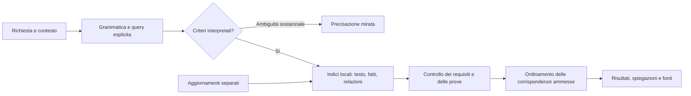

# CineMatch: ricerca cinematografica su archivio, senza modelli AI

Piano proposto il 2 novembre 2026. Non è un'implementazione né un risultato di collaudo. Sostituisce la direzione basata su servizi generativi per la nuova modalità di ricerca; non autorizza chiamate a pagamento o download massivi durante la preparazione del piano.

## 1. Decisione di prodotto

Costruire un archivio cinematografico locale interrogabile con frasi italiane, filtri e correzioni successive. Il valore distintivo consiste nel collegare ciascuna richiesta a fatti, relazioni e prove consultabili: l'utente può capire perché un film è stato trovato e quale informazione manca.

Un archivio è una soluzione valida, ma una raccolta di titoli e trame non basta a soddisfare tutte le richieste narrative. La copertura delle relazioni è il principale lavoro del progetto, più del motore di ricerca.

Non si rivendica che nessuno abbia mai realizzato ricerca cinematografica per significato, filtri o contenuti. L'originalità da perseguire è nell'esperienza combinata: richieste componibili, relazioni narrative documentate, trattamento esplicito delle informazioni mancanti, ricerca locale e spiegazioni verificabili. Un primato mondiale richiederebbe una ricerca specifica che questo piano non pretende di svolgere.

### Definizione verificabile di «senza AI»

- Nessun LLM, servizio generativo, embedding neurale, classificatore addestrato, traduttore automatico basato su modelli o modello locale necessario.
- Anche l'importazione e l'arricchimento ordinario non richiedono modelli AI.
- Interpretazione tramite lessico editoriale, grammatica dichiarativa, correzione ortografica deterministica e identificativi delle entità.
- Ricerca tramite indici testuali, insiemi, relazioni e controlli logici.
- Spiegazioni costruite dai fatti ammessi mediante modelli di frase controllati.

Gli embedding proposti nella precedente discussione sarebbero comunque AI e sono esclusi da questo progetto.

### Definizione concreta di «non costa niente»

Obiettivo: nessuna tariffa per ricerca, credito AI, abbonamento obbligatorio o server personale a pagamento. Le ricerche sull'archivio installato funzionano senza una quota commerciale di richieste.

Restano hardware, spazio, elettricità, connessione per gli aggiornamenti e tempo di sviluppo e cura dei contenuti. Le fonti online possono avere limiti di accesso e condizioni di riuso; questi riguardano l'aggiornamento, che deve essere separato dalla ricerca locale. Non si promettono hosting pubblico gratuito permanente, archivio mondiale completo o ricerca illimitata sui server di terzi.

Prima consegna pensata per uso personale/non commerciale, coerente con l'uso attuale di CineMatch. Un'eventuale distribuzione commerciale richiede una scelta dei dati compatibile con quel diverso uso, senza assumere che tutte le fonti restino gratuite.

## 2. Contratto di ricerca

1. Gli obblighi espliciti dell'utente si applicano prima dell'ordinamento.
2. Un requisito narrativo è soddisfatto solo quando esiste un'asserzione pertinente e sufficientemente verificata. Una parola nella trama non prova una relazione.
3. Informazione mancante, contraddizione e conflitto fra fonti sono stati diversi.
4. Nessun requisito importante viene ignorato perché il parser non lo capisce.
5. Una ricerca senza risultati non significa che quei film non esistano nel mondo.
6. Le alternative escludono tutti gli identificativi già mostrati nell'argomento corrente.
7. Una quantità esplicita resta esatta quando l'archivio contiene abbastanza corrispondenze; altrimenti il numero disponibile viene dichiarato. Nessun tetto globale di cinque film.
8. Senza quantità esplicita si mostra una pagina utile con il numero di risultati locali disponibili, senza cercare una quota arbitraria in rete.
9. «Tutti» restituisce l'insieme locale tramite pagine o scorrimento, senza troncare silenziosamente il totale.
10. Le modifiche successive cambiano soltanto quanto richiesto. Il contesto di visione non diventa automaticamente una proprietà della trama.

## 3. Archivio a profondità differenti

Un unico catalogo canonico, con livelli di copertura visibili, evita di far sembrare approfonditi tutti i film importati.

| Livello | Contenuto | Ricerche consentite |
| --- | --- | --- |
| Identità | Titoli, anno, tipo di opera, ID esterni | Risoluzione di titoli e omonimi |
| Catalogo | Generi, paesi, lingua, persone, durata, voti con fonte | Filtri strutturati sui campi presenti |
| Documenti | Sinossi, trame o descrizioni riutilizzabili, con provenienza | Ricerca testuale e scoperta di piste |
| Conoscenza verificata | Relazioni narrative, tono, appartenenza a correnti, avvertenze | Corrispondenze narrative documentate |

Il livello è una sintesi, non una garanzia per ogni campo: un film può avere una relazione verificata e un tono ancora sconosciuto. La disponibilità della prova si misura anche per singolo criterio.

Per le richieste precise, il numero di film approfonditi conta più del numero totale dei titoli. Cinquantamila schede con una sinossi breve non equivalgono a cinquantamila film valutabili su ogni relazione possibile.

## 4. Fonti e limiti di acquisizione

| Fonte | Uso proposto | Condizione pratica |
| --- | --- | --- |
| Wikidata | ID, collegamenti, persone e fatti strutturati disponibili | Dati strutturati CC0; completezza variabile |
| TMDB | Identità, metadati, sinossi e immagini secondo le condizioni applicabili | API gratuita per uso non commerciale con attribuzione; aggiornamenti rispettosi dei limiti |
| Wikipedia | Testi e passaggi documentali quando riutilizzabili | Provenienza e licenza per documento, attribuzione e condizioni di redistribuzione |
| IMDb non commerciale | Integrazione opzionale locale dei campi disponibili, soprattutto voti | Non è un archivio libero di trame; licenza e dati separati dal pacchetto aperto |
| Contributi CineMatch | Etichette e relazioni curate appositamente, con riferimenti | Licenza scelta esplicitamente per i contributi; revisioni tracciate |

La documentazione ufficiale specifica che gli export giornalieri TMDB contengono identificativi e alcuni attributi, non l'intero catalogo di trame e metadati. Non si pianifica un «download unico di tutto TMDB».

Strategia di acquisizione:

1. Iniziare con un insieme dichiarato di film e risolverne gli ID canonici.
2. Importare dati a lotti piccoli, riprendibili e deduplicati; evitare una richiesta globale enorme a un endpoint pubblico.
3. Conservare collegamenti e provenienza già al primo import, non ricostruirli alla fine.
4. Usare dump o estratti disponibili quando appropriati. Non richiedere il dump completo di Wikidata al PC dell'utente come prerequisito.
5. Programmare aggiornamenti incrementali con coda, pausa, ripresa, gestione di HTTP 429 e intervalli regolabili.
6. Rendere consultabile il catalogo già installato durante importazione o indisponibilità della rete.
7. Scaricare le locandine su richiesta, con cache limitata: non prelevare immagini per ogni titolo del catalogo.

Le cache TMDB e i documenti grezzi già presenti in CineMatch possono alimentare un primo import dopo il controllo di identità, data e condizioni di riuso. Le precedenti motivazioni o valutazioni prodotte dall'AI non vengono promosse automaticamente a relazioni verificate: risparmiare il download non equivale ad aver svolto la revisione editoriale.

I dati con restrizioni diverse rimangono in pacchetti distinti. Il fatto che un contenuto sia accessibile in una pagina non viene assunto come permesso di incorporarlo e ridistribuirlo. Prima di pubblicare un pacchetto, il suo manifesto deve identificare origine, licenza, attribuzioni e contenuti inclusi. Se non sono chiari, il pacchetto pubblico contiene solo dati consentiti e l'utente può usare connettori locali compatibili con le relative condizioni.

## 5. Modello dei dati

SQLite locale, con indici relazionali e FTS5 per il testo. Questa scelta si adatta al progetto desktop Rust esistente e non richiede un servizio separato. Il binding Rust e la versione saranno fissati durante l'implementazione, verificando l'abilitazione di FTS5.

Tabelle logiche principali:

| Entità | Campi essenziali |
| --- | --- |
| `film` | ID interno stabile, tipo, anno, stato dell'identità |
| `external_identity` | Fonte, ID esterno, ID film, stato della risoluzione |
| `film_title` | Testo, lingua, paese, tipo di titolo, versione dell'opera |
| `metadata_fact` | Campo, valore, fonte, data di osservazione, eventuale edizione |
| `person_credit` | Persona, ruolo, film, riferimento della fonte |
| `document` | Fonte, lingua, testo, revisione/hash, data, licenza |
| `concept` / `concept_alias` | Concetto canonico, sinonimi, lingua, relazioni esplicite |
| `character` | Entità narrativa legata a uno specifico film, specie e ruolo verificati |
| `assertion` | Soggetto, predicato, oggetto, ambito, polarità e stato della verifica |
| `assertion_evidence` | Asserzione, documento, passaggio e posizione, nota di verifica |
| `tone_annotation` | Dimensione, intensità, centralità, valutatore e riferimento |
| `review` | Autore della revisione, data, modifiche e contestazioni |
| `local_feedback` | Visti, preferenze esplicite e correzioni dell'utente |

Stati delle asserzioni: `proposta`, `verificata`, `smentita`, `contestata`, `superata`. Le prove restano collegate alla revisione del documento su cui erano state valutate. Un aggiornamento che invalida il passaggio rende la prova da ricontrollare; non eredita automaticamente la vecchia verifica.

Separare personaggi, attori e spettatori. «Con la mia ragazza» descrive gli spettatori, non una coppia nella storia; l'attore che interpreta un personaggio non diventa quel personaggio nell'archivio.

Edizioni, remake, omonimi e durate alternative non devono essere fusi solo perché hanno titoli simili. I conflitti restano visibili; per i controlli stretti sulla durata serve il dato dell'edizione pertinente o una dichiarazione di incertezza.

## 6. Il contenuto che fa la differenza

### Relazioni narrative

Esempio schematico, non attribuito a un film reale:

```text
Film X
  personaggio A: specie cane
  personaggio B: specie gatto
  relazione: A stringe amicizia con B
  centralità: significativa
  ambito temporale: evoluzione nel corso della storia
  prova: passaggio P della fonte S, revisione R
  verifica: revisione editoriale conclusa
```

Questa struttura distingue amicizia, rivalità, collaborazione occasionale e semplice presenza. Può rappresentare anche una relazione che cambia nel tempo, senza convertire ogni conflitto iniziale in una contraddizione definitiva.

Un dizionario cane/gatto/amicizia è utile a trovare passaggi da esaminare; non è sufficiente per promuovere una relazione a fatto verificato. Regole testuali possono produrre proposte di annotazione. Per diventare prova di una relazione complessa servono verifica editoriale o un dato strutturato esplicito di una fonte appropriata.

### Tono ed esperienza di visione

Definire dimensioni separate: componente comica, tensione, angoscia, violenza, malinconia, calore, soprannaturale, gotico e centralità di tali componenti. Le scale hanno descrizioni editoriali e riferimenti; non sono misure scientifiche dell'esperienza di tutti gli spettatori.

«Spooky» può essere un profilo documentato che combina componenti pertinenti. Non è sinonimo universale di Fantasy. «Non Horror» può escludere una classificazione di genere, ma non prova l'assenza di ogni scena intensa. «Piacevole» richiede un profilo editoriale dichiarato e correggibile; non va trasformato di nascosto in «per bambini».

Per contenuti molto specifici, per esempio l'assenza di morte di un animale, il silenzio di una sinossi non basta a verificare una negazione. Occorre una verifica esplicita sull'evento o una copertura della fonte adeguata a quella domanda.

### Correnti e qualità

Neorealismo, espressionismo o altre correnti richiedono un rapporto documentato: appartenenza, influenza, affinità critica sono relazioni diverse. Paese, periodo e genere aiutano la scoperta ma non dimostrano da soli l'appartenenza.

«Non solo dramma» significa cercare una componente comica significativa quando questo è l'intento, non vietare automaticamente il genere Dramma. «Bello» diventa una preferenza trasparente per qualità/valutazioni; non viene inventata una soglia numerica obbligatoria.

Le incompatibilità assolute già presenti nella tassonomia, come un tema vietato in tutte le opere di una corrente, vanno riesaminate: possono diventare suggerimenti editoriali, non esclusioni logiche senza prova.

## 7. Comprensione delle frasi senza modelli

Una grammatica componibile produce una query esplicita, con il riferimento ai segmenti originali. Il lessico iniziale è italiano, con alias inglesi per i concetti delle fonti; non si promette traduzione automatica di qualunque lingua.

Passaggi:

1. Normalizzazione di apostrofi, accenti, numeri e punteggiatura, conservando la frase originale.
2. Riconoscimento di titoli, persone, paesi, correnti, generi, periodi, durate, voti e quantità.
3. Riconoscimento di concetti e relazioni tramite lessico editoriale estensibile.
4. Costruzione di AND, OR, NOT, confronti numerici, ambiti e riferimenti fra soggetti.
5. Distinzione fra obblighi, esclusioni, preferenze e contesto di visione.
6. Evidenziazione dei segmenti importanti non interpretati, delle ambiguità e dei dati mancanti.
7. Presentazione di una lettura sintetica, modificabile, prima o insieme ai risultati.

Esempio di struttura interna:

```text
quantità = 5
obblighi = amicizia_significativa(cane, gatto)
esclusioni = Horror secondo la fonte dichiarata
preferenze = varietà, qualità
contesto = visione in coppia
```

Il parser non sarà un elenco di domande complete copiate a mano. Le regole combinano unità e strutture: lo stesso confronto di durata deve funzionare con qualunque tema supportato. Tuttavia una grammatica finita non comprende automaticamente ogni fantasia formulabile: deve poter dichiarare ciò che manca.

Correzioni ortografiche su lessico e alias, con soglie prudenti. «Neoralismo» può suggerire «neorealismo» se il candidato è univoco; titoli e persone ambigui richiedono una scelta visibile. Non correggere silenziosamente nomi verso il primo risultato popolare.

La ricerca testuale italiana non deve dipendere da uno stemmer inglese: partire da normalizzazione Unicode e forme/alias italiani controllati. FTS5 offre ricerca testuale e ranking BM25; questo ranking misura corrispondenza testuale, non verità narrativa.

### Frasi non comprese

Un segmento indispensabile non riconosciuto blocca la dichiarazione di corrispondenza completa. L'interfaccia può chiedere una sola precisazione pertinente, proporre concetti vicini o offrire ricerca nei documenti etichettata come esplorazione. Non elimina il segmento per mostrare comunque film generici.

Le richieste enciclopediche libere, le interpretazioni critiche nuove e i saggi cinematografici non vengono promessi. Spiegazioni e confronti sono possibili sui fatti effettivamente presenti nell'archivio.

## 8. Esecuzione della ricerca



Per ciascun film e criterio produrre uno stato: supportato, contraddetto, sconosciuto o contestato. Un criterio obbligatorio sconosciuto non è supportato. Una negazione è valutata nel proprio ambito, senza applicare al mondo intero ciò che vale per un personaggio o una sottotrama.

Il recupero dei candidati può unire:

- Corrispondenze testuali BM25, frasi, prefissi e sinonimi editoriali.
- Intersezioni dei filtri sui campi presenti e della fonte richiesta.
- Collegamenti fra entità e asserzioni narrative.
- Profili editoriali dichiarati per tono e occasione.

L'indice testuale serve a trovare candidati. L'ammissione finale dipende dai criteri e dalle prove. Punteggi di prossimità, popolarità o voto non possono compensare una relazione narrativa non dimostrata.

Ordine proposto: completezza delle corrispondenze obbligatorie, preferenze esplicite, aderenza dei concetti, qualità quando pertinente, varietà controllata. Criteri di ranking e spareggi restano versionati e riproducibili. Nessuna percentuale fittizia di «compatibilità».

Il conteggio totale deve essere calcolato sui risultati ammessi, non sui candidati recuperati prima dei controlli. Pagine della stessa ricerca usano una versione stabile dell'indice, così un aggiornamento in background non crea duplicati o salti a metà elenco.

I possibili risultati non verificati compaiono solo in una vista esplorativa scelta dall'utente e non contribuiscono al numero delle corrispondenze documentate.

## 9. Dialogo, filtri e personalizzazione

Mantenere lo stato locale: query attiva, vincoli, quantità, identificativi già mostrati, esclusioni esplicite, film visti e correzioni. Nessuna preferenza viene dedotta da un film suggerito dall'app e non approvato dall'utente.

Il ripristino della sessione dopo la chiusura va progettato esplicitamente, salvando versione della query e dell'archivio. Cronologia, feedback e frasi non comprese rimangono locali; nessun invio automatico a servizi di analisi per migliorare il lessico.

- «Altri», «cambia titoli», «qualcosa di diverso»: stessa query, nuovi ID.
- «Più recenti»: modifica dell'ordine o del periodo secondo la grammatica e l'eventuale precisazione, senza perdere il tema.
- «Solo sotto i 100 minuti»: aggiunta di `<100`; un dato di durata mancante non passa il filtro.
- «Togli il limite di durata»: rimozione di quel limite soltanto.
- «Rimettimi il primo»: recupero esplicito, distinto dalle alternative.
- Argomento indipendente: nuova query; nessuna eredità nascosta dei vecchi obblighi.
- «Perché questo?»: spiegazione prodotta dalle asserzioni e dalle prove usate.
- «Confronta questi due»: confronto dei campi verificati, con indicazione dei dati mancanti.

I filtri grafici e la frase devono compilare la medesima query. Non mantenere due motori con interpretazioni diverse del medesimo limite. La tassonomia deve poter crescere senza imporre che ogni nuova combinazione narrativa sia programmata come caso speciale.

## 10. Esperienza distintiva

L'utente scrive normalmente, senza compilare prima un questionario. L'app rende visibili solo le informazioni utili a comprendere o correggere i risultati.

1. **Lettura della richiesta:** pochi criteri in linguaggio chiaro; evidenziazione di un'eventuale parte non interpretata.
2. **Motivo concreto:** una o due frasi costruite dalle prove. Non riscrivere metadati già visibili e non simulare una conversazione generativa.
3. **Verifica per requisito:** possibilità di vedere quale fatto sostiene ogni richiesta e quale fonte lo documenta.
4. **Modifica immediata:** aggiungere o togliere un criterio ricalcola localmente la selezione.
5. **Copertura dichiarata:** distinguere il catalogo disponibile dai film documentati per quella relazione.
6. **Scoperta di un criterio limitante:** quando l'intersezione è vuota, mostrare quale combinazione non ha riscontri. Rimuovere un obbligo richiede una scelta dell'utente, non avviene automaticamente.
7. **Correzione del catalogo:** «Questo rapporto non è amicizia» apre una contestazione locale con riferimento al fatto; non modifica automaticamente l'archivio pubblico.
8. **Spoiler controllati:** le prove dettagliate possono restare nascoste; le motivazioni ordinarie usano solo annotazioni approvate senza spoiler.

Una spiegazione dell'assenza deve essere precisa: «Nell'archivio installato non ho una prova verificata per questo rapporto», non «Non esistono film così».

La combinazione di ricerca per relazioni, spiegazione per criterio e copertura verificabile è la direzione di prodotto da sviluppare. Non è una certificazione di unicità rispetto a tutti i servizi esistenti.

## 11. Come costruire l'archivio davvero

### Prototipo di fattibilità

Obiettivo proposto: 500 identità/metadati e 50 film con annotazioni approfondite, distribuiti fra correnti con componente comica, Halloween, amicizie fra specie, viaggi nel tempo e relativi controesempi. Questi sono traguardi da realizzare, non dati già raccolti.

Per ogni annotazione complessa: aprire la fonte appropriata, identificare l'affermazione, registrare ambito e passaggio, distinguere fatto e giudizio, riesaminare i casi dubbi. Regole deterministiche segnalano passaggi e controllano formati e coerenza; non assumono che la vicinanza di due parole provi una relazione.

Un primo campione di 20 film serve anche a misurare il tempo editoriale e la copertura effettiva delle fonti. Prima di questo campione non fissare un calendario affidabile per migliaia di schede narrative.

### Crescita dopo il prototipo

- Primo obiettivo di catalogo: 5.000–10.000 film con i campi realmente disponibili, non tutti necessariamente approfonditi.
- Primo obiettivo narrativo: 300–500 film ben documentati, scelti per coprire esigenze diverse e non solo titoli popolari anglofoni.
- Espansione per aree verificate: correnti, epoche, paesi, relazioni, toni e pubblico.
- Contributi locali esportabili in formato aperto; contributi condivisi facoltativi tramite il repository, senza un server obbligatorio.
- Revisione prima di promuovere contributi condivisi. Due segnalazioni copiate dalla stessa origine non contano come due prove indipendenti.

Il lavoro di cura è reale. Con un'ipotesi, ancora da misurare, di 15–30 minuti per film, 500 film approfonditi richiederebbero circa 125–250 ore editoriali. Schede già strutturate possono richiedere meno tempo; relazioni rare o controverse molto di più. Nessuna promessa di catalogo mondiale completo gratuitamente e in poche ore.

## 12. Spazio, aggiornamenti e funzionamento offline

Hardware rilevato: 16 GB di RAM, Intel Core Ultra 7 155U con grafica integrata. Il progetto non richiede una GPU per modelli neurali.

Dimensionare i pacchetti dopo un import campione. Esempio puramente aritmetico: 20.000 film con 15 KB medi di testo occupano circa 300 MB prima di indici, provenienza, revisioni e altri campi. Non è una stima della dimensione effettiva del database finale. Le immagini possono dominare lo spazio e restano in una cache separata e regolabile.

Progettare un archivio iniziale piccolo e pacchetti opzionali. I dati aggiornati vengono verificati in un'area temporanea, indicizzati e applicati in transazione, con controllo di versione e recupero dopo interruzione. Le annotazioni personali non vengono sovrascritte dall'aggiornamento del catalogo.

In modalità offline: ricerca, filtri, relazioni, cronologia e prove già installate restano accessibili. Locandine non scaricate, voti aggiornati e disponibilità streaming attuali non sono garantiti. Ogni dato variabile mantiene una data di osservazione; i servizi di streaming non diventano un campo «per sempre vero».

## 13. Integrazione nel repository attuale

Componenti da conservare quando corretti: interfaccia delle schede, TMDB, SIMKL, immagini, gestione credenziali, finestra dei dettagli e aggiornamento dell'app.

Componenti nuovi proposti:

```text
src/archive/
  schema.rs        dati, versioni e migrazioni
  ingest.rs        importazione riprendibile e adattatori delle fonti
  provenance.rs    fonti, licenze e revisioni delle prove
  index.rs         indici e ricerche locali
src/archive_search/
  lexicon.rs       concetti, alias e forme italiane
  parser.rs        grammatica e segmenti interpretati/non interpretati
  query.rs         query logica esplicita
  matcher.rs       criteri, relazioni e informazioni mancanti
  ranking.rs       ordinamento e varietà
  explain.rs       motivazioni e confronti dai fatti
  session.rs       seguiti, esclusioni e quantità
```

Il nome e la separazione esatta dei file possono essere ridotti durante l'implementazione. L'app coordina presentazione e attività in background, senza contenere il motore del catalogo.

Il vecchio `Facets` non basta per rappresentare relazioni e ambiti narrativi; i filtri esistenti vengono adattati alla nuova query. Il parser a regole attuale fornisce materiale da riesaminare, non viene dichiarato già sufficiente alla nuova esperienza.

Le impostazioni della modalità Archivio non costruiscono provider AI, non scaricano liste dei modelli e non effettuano chiamate ai loro endpoint, neppure per suggerimenti o ripieghi. Le credenziali precedenti non vengono cancellate automaticamente. La selezione della modalità determina esplicitamente quali componenti possono essere avviati.

Nessuna sostituzione della chat con automazioni nascoste di siti web e nessun uso di endpoint non documentati per ottenere risposte generative gratuite.

## 14. Fasi, consegne e condizioni per proseguire

| Fase | Consegna verificabile | Condizione di uscita |
| --- | --- | --- |
| 0 — Contratto | Regole del prodotto, schema delle prove, fonti utilizzabili, casi reali congelati | Nessuna dipendenza necessaria da modelli o servizi a pagamento |
| 1 — Catalogo | Import locale riprendibile di 500 film, ID, provenienza, FTS5 | Identità e aggiornamenti verificati; ricerca senza rete |
| 2 — Fattibilità narrativa | 50 film approfonditi, campione di 20 cronometrato, controesempi | Relazioni e tono supportati da prove effettive; effort misurato |
| 3 — Comprensione | Grammatica italiana, query logica, ambiguità e parti non comprese | Nessun obbligo del set di collaudo ignorato silenziosamente |
| 4 — Selezione | Controlli logici, ranking, quantità, alternative e spiegazioni | Nessuna violazione obbligatoria nel set congelato; niente ripetizioni |
| 5 — Prova d'uso | Esperienza completa con le richieste dell'utente e misure sul suo PC | Qualità, copertura e tempi valutati separatamente |
| 6 — Espansione | Pacchetti più ampi e strumenti di cura dei contenuti | Crescita sostenibile dimostrata, senza gonfiare la copertura dichiarata |
| 7 — Consegna | Build, installer, prove offline e rapporto riproducibile | Versione effettivamente installata corrispondente al codice consegnato |

La decisione più importante è dopo la fase 2: se le fonti non consentono di documentare relazioni con uno sforzo sostenibile, ridurre la promessa narrativa o cambiare la strategia dei contenuti prima di costruire un'interfaccia su un archivio vuoto. Non «risolvere» il problema introducendo di nascosto un'AI.

Nessuna data di completamento perfetta prima del campione editoriale. Gli import e i volumi reali determinano il lavoro; un elenco di fasi non sostituisce quella misura.

## 15. Collaudo e obiettivi misurabili

Creare un set esplicitamente annotato: inizialmente almeno 150 richieste, distribuite fra 30 famiglie di significato, e 30 conversazioni di più turni. Separare sviluppo e valutazione finale; riservare anche combinazioni non usate per scrivere le regole. Le varianti numeriche non diventano automaticamente nuovi temi indipendenti.

Annotare per ogni caso: query logica prevista, parti ambigue, film validi nell'archivio di prova, controesempi, prove e dati mancanti. Per il campione narrativo controverso è necessaria una seconda lettura umana; non usare il motore per certificare le proprie etichette.

| Misura | Obiettivo di accettazione proposto |
| --- | --- |
| Chiamate AI in modalità Archivio | Zero, comprese attività accessorie e ripieghi |
| Ricerche locali senza connessione | Tutti i casi relativi ai dati installati funzionano |
| Vincoli numerici, fonte dei voti, AND/OR e quantità | Tutti i casi congelati rispettati |
| Alternative | Zero ID già mostrati, salvo recupero esplicito |
| Esclusioni e relazioni obbligatorie | Zero violazioni nel campione revisionato prima della consegna |
| Precisione nei primi risultati | Target almeno 90% sul set con giudizi indipendenti; da misurare |
| Recupero delle corrispondenze note | Target almeno 85% sul sottoinsieme documentato; da misurare |
| Copertura linguistica | Misurata a parte; errori di interpretazione non nascosti tra i risultati vuoti |
| Tempi con 10.000 film | Target mediana sotto 300 ms e 95° percentile sotto 1 s sul PC dell'utente, da provare |
| Tempi con 100.000 film, se raggiunti | Nuovo benchmark; nessuna estensione automatica delle misure precedenti |

I risultati vuoti non vengono eliminati dal calcolo della copertura: un motore che rifiuta ogni richiesta non può superare il collaudo soltanto perché non propone film sbagliati. Richieste senza soluzione e film non presenti sono categorie separate.

Testare anche import interrotto, documento modificato, dati contraddittori, omonimi, durate di edizioni diverse, negazioni, assenza di prove, database parziale e recupero dopo aggiornamento. Usare server finti o dati versionati per i test automatici delle integrazioni; nessuna API a pagamento per ripetere il benchmark.

## 16. Casi essenziali dell'utente

| Richiesta | Condizione richiesta al motore |
| --- | --- |
| «Film del neoralismo belli e con comicità e non solo dramma» | Correzione visibile del movimento; appartenenza documentata; componente comica significativa; qualità come preferenza; Dramma non vietato automaticamente |
| «Amicizia tra un cane e un gatto» | Relazione significativa fra personaggi delle due specie; non basta trovare entrambi nella trama |
| «Spooky per Halloween con la mia ragazza ma non horror» | Profilo spooky documentato, esclusione del genere secondo la fonte, compagnia come contesto; nessun obbligo nascosto di romance o pubblico infantile |
| «Un film», «5 film», «12 film» | Quantità preservata; nessun massimo di cinque; disponibilità locale dichiarata |
| Cinque seguiti che chiedono altre proposte | Nessun duplicato e stessi criteri |
| «Solo sotto i 100 minuti», poi «togli il limite» | Modifica e rimozione della durata senza perdere gli altri criteri |
| «IMDb sopra 8 tra il 1993 e il 1997» | Fonte IMDb e comparatore stretto; nessuna sostituzione con TMDB |
| «Una bibliotecaria in pensione amica di un polpo su Marte» | Conservare tutti i concetti; dichiarare interpretazione o copertura insufficienti; niente riempimento con film spaziali generici |
| «Non deve morire il cane» | Esito narrativo verificato; assenza del tema nella sinossi non sufficiente |

La conversazione continua ad accettare testo libero, ma la dichiarazione di comprensione dipende dalla grammatica e dai concetti effettivamente supportati. Questo limite va verificato con le richieste reali prima della migrazione.

## 17. Decisioni fissate e questioni da misurare

Fissato: nessun modello AI, nessun costo per query al fornitore, ricerca locale, prove per le relazioni, quantità libera, memoria delle alternative, niente rilassamenti nascosti, niente presunta copertura universale.

Da misurare nel prototipo: copertura delle fonti narrative, tempo di annotazione, frequenza delle frasi non comprese, dimensione del database, qualità sui casi reali e tempi sul PC dell'utente. Da questi dati dipendono ampiezza e calendario della prima versione, non da una promessa di perfezione.

Il progetto è valido se l'archivio documentato e la grammatica coprono davvero gli usi dell'utente con un lavoro sostenibile. L'archivio non elimina il lavoro: lo sposta dalla generazione a ogni domanda alla preparazione, verifica e riuso dei contenuti.

## Fonti tecniche consultate

- [TMDB FAQ: uso gratuito non commerciale e attribuzione](https://developer.themoviedb.org/docs/faq).
- [TMDB: contenuto degli export degli identificativi](https://developer.themoviedb.org/docs/daily-id-exports).
- [TMDB: gestione dei limiti e HTTP 429](https://developer.themoviedb.org/docs/rate-limiting).
- [Wikidata: licenza dei dati strutturati](https://www.wikidata.org/wiki/Wikidata:Licensing).
- [Wikidata: modalità di download dei dati](https://www.wikidata.org/wiki/Wikidata:Database_download).
- [Wikimedia: riuso, attribuzione e condizioni dei contenuti](https://foundation.wikimedia.org/wiki/Policy:Terms_of_Use#7._Licensing_of_Content).
- [IMDb: campi e condizioni dei dataset non commerciali](https://data.imdb.com/non-commercial-datasets/).
- [SQLite FTS5: ricerca testuale, ranking e tokenizzazione](https://www.sqlite.org/fts5.html).

Le quantità dei prototipi, la struttura del catalogo, gli obiettivi di qualità e i tempi di risposta sono proposte progettuali di CineMatch, non garanzie fornite da queste fonti.
