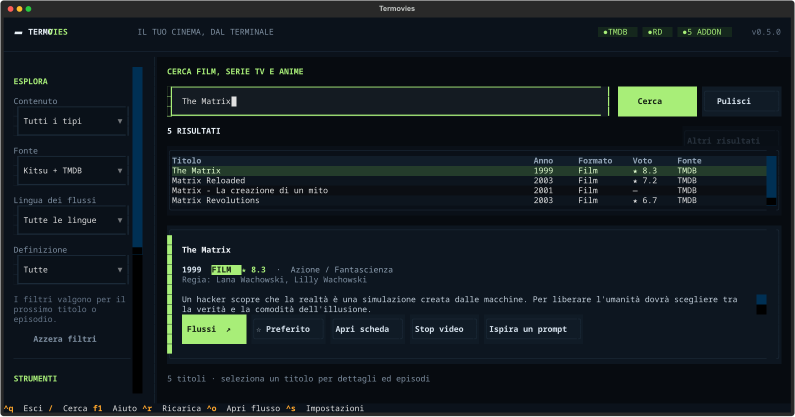

# Termovies Terminal

Film, serie, anime, TV, 74 correnti cinematografiche e prompt in una sola
interfaccia da terminale. Avvio: `termovies`.



## Installazione rapida — Linux / Ubuntu / Arch

```sh
curl -fsSL https://github.com/Emanueleparis98/termovies/releases/latest/download/install.sh | sh
termovies
```

L’installer scarica l’ultima release pubblicata, verifica lo SHA-256 e crea un
ambiente isolato con uv e Python 3.13. Non richiede Git, Node, Rust o un login
GitHub. Non usa pip di sistema. Se il comando non compare subito, riapri il
terminale. Per aggiornare riesegui la stessa riga: impostazioni e libreria
restano in `~/.config/termovies` e `~/.local/share/termovies`.

Installa anche un player: `sudo pacman -S mpv` su Arch/CachyOS oppure
`sudo apt install mpv` su Ubuntu. VLC e ffplay sono alternative.

### Arch · pacchetto nativo

```sh
curl -fLO https://github.com/Emanueleparis98/termovies/releases/download/terminal-v0.5.0/termovies-0.5.0-1-any.pkg.tar.zst
sudo pacman -U ./termovies-0.5.0-1-any.pkg.tar.zst
termovies
```

È un pacchetto del progetto, non un pacchetto nei repository ufficiali Arch o
nell’AUR. Se passi dall’installer uv a pacman, esegui prima `uv tool uninstall termovies`
per evitare che la copia in `~/.local/bin` preceda quella di sistema.
La release contiene anche `PKGBUILD`, `termovies-0.5.0-arch-build.tar.gz` e i
sorgenti per una build con `makepkg`.

## Windows · PowerShell

```powershell
powershell -NoProfile -ExecutionPolicy Bypass -Command "irm https://github.com/Emanueleparis98/termovies/releases/latest/download/install.ps1 | iex"
termovies
```

## Windows · Scoop

```powershell
scoop bucket add termovies https://github.com/Emanueleparis98/termovies
scoop install termovies/termovies
termovies
```

Aggiornamento: `scoop update; scoop update termovies`.
È un bucket del progetto; non è una pubblicazione nel catalogo WinGet.
Installa [mpv](https://mpv.io/installation/) o [VLC](https://www.videolan.org/vlc/).
Il player trova anche VLC nella cartella standard di Windows e in `/Applications` su macOS.

## Alternativa universale con uv / pipx

Con uv già presente:

```sh
uv tool install --python 3.13 git+https://github.com/Emanueleparis98/termovies.git
termovies
```

È supportato anche `pipx install git+https://github.com/Emanueleparis98/termovies.git`
con Python 3.11 o successivo e Git installato. I wheel della release sono comuni
a Linux, macOS e Windows; per installarli manualmente:
`uv tool install --python 3.13 ./termovies-0.5.0-py3-none-any.whl`.

## Aggiornamento

- Installer rapido Linux/Windows: riesegui lo stesso comando; le impostazioni restano.
- Scoop: `scoop update; scoop update termovies`.
- Arch: scarica il nuovo pacchetto e installalo con `sudo pacman -U`.
- uv/pipx da Git: reinstalla con `uv tool install --force …` o `pipx reinstall termovies`.
- Rimozione: `uv tool uninstall termovies`.

Gli indici ufficiali apt/Ubuntu, Arch e WinGet seguono procedure separate: il
progetto non dichiara `apt install termovies`, `pacman -S termovies` o
`winget install termovies` come comandi già disponibili.

## Come si usa

1. In **Esplora**, scegli Contenuto (Film, Serie TV, Anime o Canali TV) e Fonte.
   **Kitsu + TMDB** cerca nelle fonti integrate, **Addon collegati** include i tuoi
   addon personali, **TMDB** limita la ricerca al solo TMDB.
   Scrivi il titolo nella barra e premi **Cerca**: i risultati appaiono subito sotto.
   La schermata iniziale è vuota e non carica cataloghi popolari.
   Preferiti e Cronologia si scelgono da Contenuto.
2. La scheda mostra trama, anno, generi, valutazione, regia e cast quando presenti.
   Collega TMDB per ricerca e metadati in italiano di film e serie; il catalogo
   Anime Kitsu è integrato e non richiede chiavi.
3. Da **Addon** aggiungi il link `manifest.json` del tuo addon, anche `stremio://`.
   Puoi attivarlo, disattivarlo e rimuoverlo. Sono rispettati tipi e prefissi degli ID.
4. In **Impostazioni** collega Real-Debrid oppure TorBox una volta. I torrent
   restituiti da qualsiasi addon compatibile usano questa chiave globale; il manifest
   dell’addon non viene riscritto e le sue altre impostazioni restano necessarie.
5. Scegli stagione ed episodio quando il titolo è una serie o un anime, poi **Flussi**.
   Puoi cambiare stagione ed episodio anche direttamente nel pannello **Flussi**:
   le sorgenti si aggiornano automaticamente per l’episodio scelto, mantenendo i filtri.
   I filtri **Lingua dei flussi** e **Definizione**, nel pannello Esplora, vengono
   applicati al titolo o episodio scelto. Puoi modificarli anche nel pannello Flussi,
   cercare per nome/addon e premere **Riproduci**. Le scelte vengono ricordate.
   Se non ci sono corrispondenze, **Azzera** mostra di nuovo tutti i flussi.
6. Preferiti e cronologia restano locali. La cronologia seleziona l’ultimo episodio avviato.
   Con mpv su Linux viene conservata anche la posizione, separata per ogni episodio.

Il tema e la disposizione seguono TermSport: pannello Esplora a sinistra, barra di
ricerca in alto, risultati e scheda del titolo sotto, colori verde e blu scuro.
Lingua e definizione si riferiscono ai flussi dichiarati dalle fonti, non alla lingua
originale del film. “SUB-ITA” indica sottotitoli italiani e non viene confuso con
audio italiano; “MULTI” senza lingue esplicite non garantisce una traccia italiana.
Le sorgenti senza informazioni rimangono visibili scegliendo “Tutte” o “Non indicata”.
Un’etichetta generica “HD” non viene trasformata in 720p o 1080p.

La sezione **TV** usa i cataloghi `tv`/`channel` degli addon personali: non contiene
una lista di canali preinstallata. **Apri URL / JSON** accetta un URL HTTP/HTTPS,
un elenco `streams` JSON o un file JSON locale. L’importazione dei flussi è temporanea.

I flussi arrivano esclusivamente dagli addon collegati. I torrent vengono risolti
con il servizio debrid scelto; un titolo presente nei cataloghi non garantisce
una fonte riproducibile.

Il video parte in una finestra mpv/VLC/ffplay. Audio, sottotitoli, seek e schermo
intero sono gestiti dal player. HTTP, HLS, DASH e i codec dipendono dal player e
dalla sorgente. Gli header di richiesta degli addon sono inoltrati a mpv; le fonti
che richiedono header non gestiti da VLC chiedono di scegliere mpv.

La ricerca predefinita usa TMDB per film e serie e il catalogo Anime Kitsu
integrato; per film e serie è consigliata una chiave TMDB. Scegli **Addon
collegati** per cercare anche nei cataloghi degli addon personali. Per la
riproduzione aggiungi i tuoi addon manifest JSON e installa mpv o VLC.
Le chiavi Real-Debrid/TorBox vengono configurate una sola volta per i torrent
restituiti dagli addon. I servizi mantengono le proprie restrizioni.

La generazione dei prompt è locale e gratuita. Puoi scrivere liberamente oppure
scegliere fino a quattro correnti, impostare obiettivo, quantità, profondità,
preferenze, esclusioni e titoli già visti. Copia il prompt nella chat che preferisci.

**Correnti** cerca anche per autore, opera, paese e sinonimo, e mostra caratteristiche,
contesto, confini storiografici e fonti. **Componi prompt** conserva le selezioni quando
passi alla modalità libera, ma non le inserisce nel testo finché non scegli un obiettivo
con correnti. Puoi modificare il risultato, copiarlo, salvarlo come `prompt.txt`, oppure
copiarlo e aprire ChatGPT, DeepSeek, Claude o Gemini. Non vengono inviati messaggi automaticamente.

I prompt e le correnti funzionano offline. Se usi Wayland e gli appunti non funzionano,
installa `wl-clipboard`; su X11 puoi usare `xclip`. Rimane disponibile il copia tramite OSC52
se il terminale lo consente.

| Tasto | Azione |
| --- | --- |
| `/` | Ricerca |
| `Ctrl+K` | Correnti |
| `Ctrl+P` | Compositore prompt |
| `Ctrl+A` | Addon, quando il campo attivo non usa il tasto per selezionare il testo |
| `Ctrl+S` | Impostazioni |
| `Ctrl+O` | Apri URL / JSON |
| `Ctrl+X` | Ferma il video |
| `Ctrl+Invio` | Genera il prompt nel compositore |
| `Esc` | Chiudi il pannello |
| `Ctrl+Q` | Esci |

## Comandi senza interfaccia

```sh
termovies search "The Matrix" --type movie
termovies search "Cowboy Bebop" --type anime --json
termovies currents "Rossellini"
termovies prompt "Consigliami tre anime brevi, senza spoiler"
termovies doctor
termovies configure
termovies addons add
termovies addons list
```

`configure` e `addons add` chiedono le credenziali e i manifest personali in modo nascosto,
così non finiscono nella cronologia della shell. `doctor` mostra percorsi e stato della
configurazione senza stampare chiavi o manifest personali. Credenziali e manifest
restano nella configurazione locale di Termovies Terminal.

## Dati locali e disponibilità

Configurazione e libreria usano le cartelle standard dell’utente (`termovies doctor`
mostra i percorsi). Le chiavi sono memorizzate localmente **senza cifratura**, con file
0600 su Linux. Non vengono inviate alle chat AI. TMDB riceve le ricerche quando collegato;
gli addon ricevono ricerche e ID dei titoli; il servizio debrid riceve gli hash selezionati.
Le attività debrid sono separate per account anche quando cambi la chiave.

Nessun client torrent P2P viene avviato: per i torrent serve un servizio debrid
compatibile e abilitato. I rifiuti legali, incluso Real-Debrid 451/codice 35, vengono
mostrati e non aggirati. La disponibilità dei cataloghi e dei flussi dipende dai servizi:
un titolo trovato nel catalogo non garantisce una sorgente riproducibile. Le pagine
esterne si aprono con **Apri fonte**; non vengono trattate come file video.

## Sviluppo e distribuzione

Dal repository principale:

```sh
uv venv --python 3.13
uv pip install -e '.[dev]' build
.venv/bin/python -m pytest -q
.venv/bin/python terminal/scripts/build-release.py
.venv/bin/python terminal/scripts/check-install.py
```

Su Windows usa `.venv\Scripts\python.exe`. La wheel comprende le 74 correnti e il
tema TUI. Il workflow **Termovies Terminal** controlla Linux e Windows con Python
3.11, 3.13 e 3.14, l’installazione in un ambiente isolato e il pacchetto nativo Arch.
La verifica post-pubblicazione controlla anche il download anonimo e Scoop.

I tag `terminal-v*` e il file `latest.json` nella release identificano l’ultima versione.
La release contiene wheel, sdist, installer, `SHA256SUMS`, scoop zip, `PKGBUILD`,
`arch-build` e il pacchetto Arch. Il pacchetto nativo viene prodotto nel job `arch`.
Per pubblicare, crea il tag `terminal-v<versione>` e una release GitHub con gli asset
di `terminal/dist/release`, includendo il pacchetto Arch e marcandola come **Latest**.

Questa cartella contiene l’applicazione Python principale.
